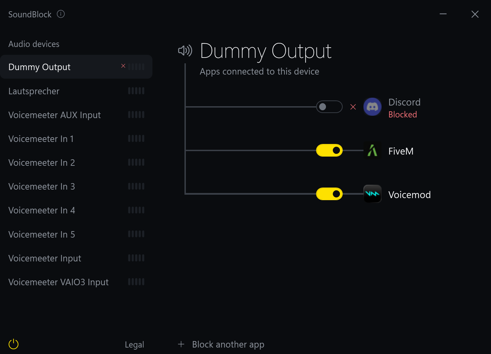

# SoundBlock

SoundBlock lets you choose which applications can use each audio device on your Windows PC.

## Why it exists

Some microphone software sends your voice through an audio device that Windows treats as a speaker. Voice changers such as Voicemod can do this, and so can the software of some microphones. Discord's desktop stream and other streaming software then record that device like any other sound output, so your microphone loops back into the stream and your viewers hear you twice.

Windows has a fix: you can mute the app on that one device in the volume mixer. But Windows remembers that setting for the exact folder a program runs from, and some apps, such as Discord, change folder with every update. So after each update the setting is gone, and your viewers hear you twice again.

SoundBlock keeps the block in place for you, for any app on any device.

## Download

[Download SoundBlock for Windows](https://github.com/DEVACT-HQ/SoundBlock/releases/latest/download/SoundBlock.exe)

Save the file to a folder such as Documents and open it. There is nothing to install. The first time you open SoundBlock, Windows may show a security notice because it does not yet recognize the publisher. Select **More info**, then **Run anyway**.

## Getting started

1. Open SoundBlock. If you use Voicemod, Discord is already blocked from its devices.
2. Select an audio device from the list on the left.
3. Turn off the switch next to each application that should not use this device. To block an app that isn't on the device yet, select **Block another app**.
4. To start SoundBlock automatically with Windows, select the power icon at the bottom left.

SoundBlock keeps running after you close its window. You can reopen it from its icon near the clock on your taskbar. To exit, right-click that icon and select **Exit**. When a new version is available, an **Update** button appears at the bottom right of the window.

## How it works

Each audio device has its own page. Every app connected to a device hangs off it by a wire, and the wire lights up when sound runs through it. A blocked app's wire stays dark, and a ✕ in the list marks devices with a blocked app.

- **A block cuts one connection.** It is the same mute as in the Windows volume mixer, so the app goes silent on that device and keeps working on all the others. If the app is playing when you block it, SoundBlock asks first.
- **Updates change nothing.** SoundBlock recognizes apps by name, not by folder.
- **Blocks stay enforced.** While SoundBlock runs, it checks twice a second and blocks an app again if anything let it back in.
- **Exiting leaves blocks in place.** To allow an app again, switch it back on.

SoundBlock has no account and collects no data. To find new versions it checks GitHub, which sees your IP address when it does. To stop this, right-click its icon and turn off **Check for updates**.

## About

SoundBlock is developed by Devact. See the [imprint, privacy notice and terms of use](LEGAL.md). To report a security problem, see [SECURITY.md](SECURITY.md).

SoundBlock is not affiliated with Discord, Voicemod or any other app it works with.

© 2026 Devact. All rights reserved.
